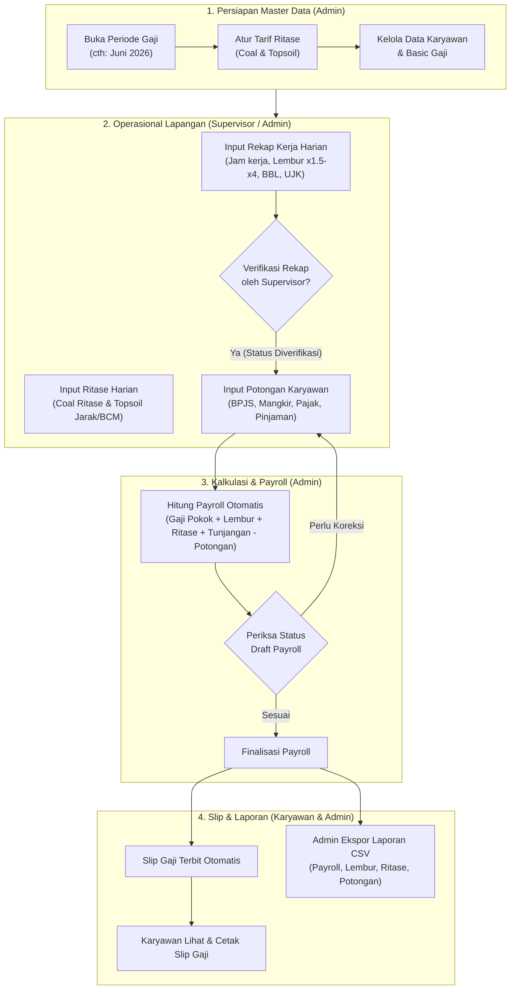

# Log Percakapan Project Puput (Payroll GJP)

## 👤 User

<USER_REQUEST>
tolong buat ui uxnya responsive all device dong, di pcku rapi, di macbookku ga rapi, cek foto
</USER_REQUEST>
<ADDITIONAL_METADATA>
The current local time is: 2026-10-26T21:13:20+08:00.

The user has uploaded 1 image(s):
- /Users/utiebrandstore/.gemini/antigravity/brain/e825bd31-a20b-4172-8500-cd24c074bb30/.user_uploaded/media_1793020363362_90407a30.png
You can embed this image in an artifact if you need the USER to review it.
</ADDITIONAL_METADATA>
<USER_SETTINGS_CHANGE>
The user changed setting `Model Selection` from None to Gemini 4 Argon (Medium). No need to comment on this change if the user doesn't ask about it. If reporting what model you are, please use a human readable name instead of the exact string.
</USER_SETTINGS_CHANGE>

---

## 🤖 Antigravity Assistant

Sudah diperbaiki dan di-build ulang agar **responsive & rapi di semua perangkat** (PC, MacBook 13"–16", Tablet, dan Mobile).

### Penyebab tampilan berantakan di MacBook sebelumnya:
1. **Asset Vite (`public/build`) belum ter-build ulang** setelah update fitur logo & profil terakhir, sehingga class CSS baru (seperti `.brand-logo`, `.user-profile-link`, dan warna tema) belum termuat di MacBook—membuat gambar logo `GJP` tampil sangat besar dan mendorong teks **PT GADING JAYA PERKASA** keluar dari sidebar.
2. **Grid kartu laporan & statistik terlalu sempit di layar laptop (1280px–1440px)**:
   - Di halaman **Laporan**, deskripsi 2 baris (*"Rekap jam dan biaya lembur"*) membuat posisi dropdown periode dan tombol **Export CSV** turun/tidak sejajar dengan kartu di sebelahnya.

### Perubahan yang telah dilakukan:
- **[app.css](file:///Users/jaya/puput-project/resources/css/app.css)**:
  - **Kartu Laporan (`.report-cards` & `.report-card`)**: Menggunakan `repeat(auto-fit, minmax(190px, 1fr))` dan `flex-direction: column` dengan `margin-bottom: auto` pada deskripsi, sehingga dropdown periode & tombol **Export CSV** selalu rata bawah sempurna walaupun panjang teks deskripsi berbeda.
  - **Kartu Statistik Dashboard (`.stats-grid` & `.stat`)**: Menggunakan grid adaptif dan `clamp()` pada ukuran angka agar nominal rupiah besar tidak keluar dari kartu di layar MacBook.
  - **Sidebar & Profil (`.sidebar`, `.brand`, `.user-card`)**: Mengunci ukuran `.brand-logo`, menambahkan `overflow-y: auto` untuk layar pendek, serta `text-overflow: ellipsis` pada nama/email agar tombol logout tidak terdorong keluar.
  - **Form & Tabel (`.entry-grid`, `.summary-layout`, `.payroll-grid`, `.data-table`)**: Menyesuaikan kolom otomatis di setiap ukuran layar serta mengatur `min-width` input di dalam tabel agar tidak gepeng di layar laptop/HP.
  - **Halaman Login (`.login-screen`)**: Memperbaiki posisi copyright agar tidak menumpuk kartu login di layar MacBook yang lebih pendek.
- **[aplikasi.blade.php](file:///Users/jaya/puput-project/resources/views/layouts/aplikasi.blade.php)** & **[app.js](file:///Users/jaya/puput-project/resources/js/app.js)**:
  - Menambahkan atribut dimensi eksplisit pada logo dan `sidebar-backdrop` (klik di luar sidebar atau tekan `Esc` untuk menutup menu pada tampilan mobile/tablet).
- **[ritase/index.blade.php](file:///Users/jaya/puput-project/resources/views/ritase/index.blade.php)**:
  - Membungkus semua tabel tarif & riwayat dengan `.table-scroll` agar aman di layar kecil.
- Menjalankan `npm run build` sehingga file hasil kompilasi di `public/build` sudah diperbarui. Silakan **refresh (`Cmd + Shift + R`)** browser di MacBook Anda.

---

## 👤 User

<USER_REQUEST>
jelasin flow aplikasinya dong tolong dari ke 3 role tersebut
</USER_REQUEST>
<ADDITIONAL_METADATA>
The current local time is: 2026-10-27T03:23:10+08:00.
</ADDITIONAL_METADATA>
<USER_SETTINGS_CHANGE>
The user changed setting `Model Selection` from Gemini 4 Argon (Medium) to Gemini 3.8 Flash (High). No need to comment on this change if the user doesn't ask about it. If reporting what model you are, please use a human readable name instead of the exact string.
</USER_SETTINGS_CHANGE>

---

## 🤖 Antigravity Assistant

Sistem Informasi Penggajian **PT Gading Jaya Perkasa (GJP)** dirancang dengan pemisahan tugas (*separation of duties*) antara operasional lapangan, pengelolaan keuangan/HR, dan karyawan.

---

### Diagram Alur Utama (End-to-End Workflow)



---

### Rincian Flow dari Sudut Pandang ke-3 Role

#### 1. Role: Supervisor (Operasional Lapangan / Site)
> **Tugas Utama**: Mencatat aktivitas fisik harian alat berat & driver di lapangan serta memvalidasi keabsahan data kerja sebelum dihitung upahnya.

* **Akses Keamanan**: Tidak memiliki akses ke data nominal uang sensitif (tidak bisa melihat gaji pokok, total rupiah payroll perusahaan, atau menu pengaturan tarif).
* **Alur Kerja**:
  1. **Rekap Absensi & Jam Kerja**:
     - Memilih nama karyawan dan tanggal kerja pada periode aktif.
     - Menginput jam kerja normal serta jam lembur berjenjang (`x1.5`, `x2`, `x3`, `x4`).
     - Menginput tunjangan lapangan jika ada (BBL = Bahan Bakar/Beban Lapangan, UJK = Uang Jalan/Kerja).
     - Mengklik **Verifikasi** pada rekap yang valid. *(Catatan: Sistem mewajibkan rekap terverifikasi sebelum payroll bisa dihitung)*.
  2. **Pencatatan Ritase**:
     - **Coal**: Menginput jumlah ritase batubara harian driver.
     - **Topsoil**: Menginput jarak angkut (KM), volume (BCM), jumlah ritase, serta bonus operasional.
  3. **Dashboard Monitoring**:
     - Memantau total jam lembur dan total akumulasi ritase unit di lapangan.

---

#### 2. Role: Admin (HR & Payroll Manager)
> **Tugas Utama**: Pemegang kendali penuh siklus penggajian, verifikasi finansial, penetapan potongan, finalisasi slip gaji, dan pelaporan manajemen.

* **Alur Kerja**:
  1. **Inisialisasi Master Data**:
     - **Pengaturan**: Membuka periode gaji baru (status: `aktif`) dan mengonfigurasi batas jarak serta tarif ritase (Coal per ritase, Topsoil per BCM).
     - **Karyawan**: Menambah atau memperbarui data karyawan, NIK, jabatan, dan basic rate (UPPK/Gaji Pokok). Akun login karyawan dibuat secara otomatis.
  2. **Audit Operasional & Potongan**:
     - Memastikan seluruh rekap harian telah diverifikasi oleh Supervisor.
     - Menambahkan penyesuaian potongan pada menu Payroll (seperti mangkir, iuran BPJS, kasbon/pinjaman, atau PPh 21).
  3. **Kalkulasi Payroll Otomatis**:
     - Mengklik tombol **Hitung Payroll**. Sistem menghitung secara otomatis:
       $$\text{Upah Jam Lembur} = \frac{\text{Gaji Pokok}}{173}$$
       $$\text{Lembur} = \sum (\text{Jam} \times \text{Faktor Lembur}) \times \text{Upah Jam}$$
       $$\text{Gaji Bersih} = (\text{Gaji Pokok} + \text{Lembur} + \text{Ritase Coal} + \text{Ritase Topsoil} + \text{Tunjangan BBL/UJK}) - \text{Potongan}$$
     - Status awal payroll adalah **Draft** sehingga Admin dapat mengecek ulang atau menghitung kembali jika ada revisi.
  4. **Finalisasi & Publikasi**:
     - Mengklik **Finalisasi & Publikasikan Slip**. Sistem otomatis mengunci perhitungan dan menerbitkan dokumen slip gaji ke akun karyawan terkait.
  5. **Export & Arsip**:
     - Mengunduh rekap dalam format **CSV** di menu **Laporan** (Laporan Payroll, Lembur, Ritase, Potongan, dan Karyawan) untuk kebutuhan pembukuan bank (*payroll transfer*) atau arsip manajemen.

---

#### 3. Role: Karyawan (Operator, Driver, Mekanik, Staf)
> **Tugas Utama**: Self-service karyawan untuk transparansi kehadiran, ritase, dan pencetakan slip gaji pribadi.

* **Akses Keamanan**: *Strict Data Scoping* — karyawan hanya bisa melihat datanya sendiri dan tidak memiliki akses ke data karyawan lain.
* **Alur Kerja**:
  1. **Cek Rekap Kerja Harian**:
     - Memantau daftar absensi harian pada periode berjalan.
     - Memastikan status jam kerja dan lembur miliknya sudah diinput dan berstatus **"Terverifikasi"**.
  2. **Cek Ritase Pribadi**:
     - Melihat akumulasi ritase batubara atau topsoil yang sudah tercatat atas namanya.
  3. **Menerima & Mencetak Slip Gaji**:
     - Pada menu **Payroll & Slip Gaji**, ketika status payroll telah difinalisasi oleh Admin, karyawan dapat membuka halaman rincian slip gaji.
     - Karyawan dapat langsung mencetak (*print*) atau menyimpannya sebagai PDF (format slip sudah otomatis dioptimasi untuk cetak kertas/A4 tanpa elemen navbar/sidebar).

---

### Ringkasan Matriks Akses Fitur

| Fitur / Menu | Admin | Supervisor | Karyawan |
| :--- | :---: | :---: | :---: |
| **Kelola Master Karyawan & Akun** | ✅ Penuh | ❌ | ❌ |
| **Buka/Tutup Periode & Tarif Ritase** | ✅ Penuh | ❌ | ❌ |
| **Input Rekap Kerja & Lembur** | ✅ | ✅ | ❌ *(Hanya Lihat Milik Sendiri)* |
| **Verifikasi Rekap Kerja** | ✅ | ✅ | ❌ |
| **Input Ritase Coal & Topsoil** | ✅ | ✅ | ❌ *(Hanya Lihat Milik Sendiri)* |
| **Input Potongan Gaji (BPJS/Pajak)** | ✅ | ❌ | ❌ |
| **Hitung & Finalisasi Payroll** | ✅ | ❌ | ❌ |
| **Cetak Slip Gaji** | ✅ *(Semua Karyawan)* | ❌ | ✅ *(Hanya Milik Sendiri & Final)* |
| **Ekspor Laporan CSV** | ✅ | ❌ | ❌ |

---

## 👤 User

<USER_REQUEST>
jelasin fungsi fungsi flow dari 
foto tersebut dong apa aja
</USER_REQUEST>
<ADDITIONAL_METADATA>
The current local time is: 2026-11-02T16:25:25+08:00.

The user has uploaded 1 image(s):
- /Users/utiebrandstore/.gemini/antigravity/brain/e825bd31-a20b-4172-8500-cd24c074bb30/.user_uploaded/media_1793607893588_1aeb8937.png
You can embed this image in an artifact if you need the USER to review it.
</ADDITIONAL_METADATA>

---

## 🤖 Antigravity Assistant

Foto tersebut menampilkan formulir **Input Rekap Kerja & Lembur Harian** yang ada pada menu **Rekap Kerja**. Formulir ini digunakan oleh **Supervisor** dan **Admin** untuk mencatat absensi, jam operasional, lembur, serta tunjangan harian per karyawan sebelum diproses ke sistem penggajian (*payroll*).

Berikut penjelasan detail fungsi tiap kolom (*field*) dan alur (*flow*) kerjanya:

---

### 1. Fungsi Masing-Masing Input Form

| Field / Input | Fungsi & Kegunaan |
| :--- | :--- |
| **Tanggal** | Menentukan tanggal aktivitas kerja karyawan yang dicatat (harus berada dalam rentang periode gaji berjalan, misal: `01/06/2026`). |
| **Status** | Status kehadiran karyawan pada tanggal tersebut. Pilihan: <br>• **`hadir`**: Masuk kerja normal.<br>• **`standby`**: Siap kerja di *site* / menunggu instruksi alat.<br>• **`izin` / `sakit` / `mangkir`**: Ketidakhadiran kerja. |
| **Total Jam** | Durasi jam kerja reguler yang diselesaikan (default: `8` jam untuk *shift* normal). |
| **x1,5** | Jumlah **jam lembur pertama** pada hari kerja biasa (dikalikan tarif lembur $1{,}5\times$). |
| **x2** | Jumlah **jam lembur kedua dan seterusnya** pada hari kerja biasa, atau **jam awal lembur di hari libur** (dikalikan tarif lembur $2\times$). |
| **x3** | Jumlah **jam lembur lanjutan** pada hari libur resmi/akhir pekan (dikalikan tarif lembur $3\times$). |
| **x4** | Jumlah **jam lembur maksimal/tertinggi** (jam ke-9 ke atas pada hari libur besar, dikalikan tarif lembur $4\times$). |
| **BBL** | **Bahan Bakar Lapangan / Biaya Beban Lapangan** (dalam Rupiah). Tunjangan penggantian operasional harian yang diberikan langsung ke karyawan. |
| **UJK** | **Uang Jam Kerja / Uang Jalan Khusus** (dalam Rupiah). Tunjangan harian berbasis intensitas penugasan lapangan. |
| **Keterangan** | Catatan tambahan kondisi operasional (misal: *"Hujan deras alat standby 2 jam"*, *"Perbaikan loader"*, *"Shift malam"*). |
| **Tombol "Simpan Rekap"** | Menyimpan data log harian ke database sistem. |

---

### 2. Rumus & Dampak ke Penggajian (*Behind the Scenes*)

Data yang diinput pada formulir ini langsung menjadi dasar perhitungan pada modul **Payroll**:

1. **Perhitungan Lembur Otomatis**:
   Sistem menghitung upah lembur per jam berdasarkan standar Depnaker:
   $$\text{Upah per Jam} = \frac{\text{Gaji Pokok}}{173}$$
   $$\text{Total Upah Lembur} = \left[ (x1{,}5 \times 1{,}5) + (x2 \times 2) + (x3 \times 3) + (x4 \times 4) \right] \times \text{Upah per Jam}$$

2. **Perhitungan Tunjangan Lapangan**:
   $$\text{Total Tunjangan} = \text{BBL} + \text{UJK}$$

---

### 3. Alur Kerja (Flow Data Setelah Disimpan)

```
[1. Input Rekap] ──> [2. Status: Menunggu] ──> [3. Tombol Verifikasi] ──> [4. Masuk Kalkulator Payroll]
(Supervisor/Admin)   (Belum bisa dihitung)     (Disetujui Supervisor)     (Gaji Pokok + Lembur + Tunjangan)
```

1. **Langkah 1 (Input & Simpan)**:
   Supervisor memilih nama karyawan, mengisi form sesuai data absensi lapangan/timesheet, lalu menekan tombol **Simpan Rekap**.
2. **Langkah 2 (Validasi Awal)**:
   Data yang baru disimpan akan masuk ke tabel rekap di bawahnya dengan status **`Menunggu`** (belum diverifikasi).
3. **Langkah 3 (Verifikasi Lapangan)**:
   Supervisor/Admin menekan tombol **Verifikasi** pada baris data tersebut setelah memeriksa kecocokan dengan laporan fisik lapangan.
   > **Penting**: Sistem memproteksi kalkulasi payroll — jika rekap belum berstatus **"Terverifikasi"**, sistem akan menolak dan tidak mengizinkan Admin menghitung gaji karyawan tersebut.
4. **Langkah 4 (Otomatis Masuk Slip Gaji)**:
   Saat Admin menekan tombol *Hitung Payroll*, semua jam lembur ($x1{,}5$ s/d $x4$) dan tunjangan (BBL & UJK) yang sudah diverifikasi akan terakumulasi otomatis ke dalam **Gaji Kotor** dan tercetak di **Slip Gaji**.

---

## 👤 User

<USER_REQUEST>
trus ini apaa
</USER_REQUEST>
<ADDITIONAL_METADATA>
The current local time is: 2026-11-02T16:26:48+08:00.

The user has uploaded 1 image(s):
- /Users/utiebrandstore/.gemini/antigravity/brain/e825bd31-a20b-4172-8500-cd24c074bb30/.user_uploaded/media_1793608003702_e3a8d1ce.png
You can embed this image in an artifact if you need the USER to review it.
</ADDITIONAL_METADATA>

---

## 🤖 Antigravity Assistant

Halaman ini adalah **Modul Pencatatan Ritase (Coal & Topsoil)**. 

Di industri pertambangan, selain gaji pokok dan jam lembur, driver dump truck (*DT*) dan operator alat berat biasanya mendapatkan **insentif ritase/tonase/jarak** berdasarkan hasil produksi angkutan material yang mereka bawa.

Halaman ini terbagi menjadi dua sektor utama: **Ritase Coal (Batubara)** dan **Ritase Topsoil (Tanah Pucuk/Overburden)**.

---

### 1. Filter Navigasi (Pojok Kanan Atas)
* **Karyawan**: Memilih nama driver/operator yang akan diinput atau dilihat pencapaiannya (pada foto: *Taufik*).
* **Periode**: Memilih bulan gaji yang aktif (pada foto: periode Juni 2026 / `06/2026`).
* **Tombol Tampilkan**: Menampilkan data rekap ritase karyawan pada periode yang dipilih.

---

### 2. Sektor Atas: Ritase Coal (Batubara)

Sistem ritase batubara menggunakan **Sistem Progresif (Tiering Target)**:

* **Form Input Ritase Coal**:
  * **Tanggal**: Tanggal pencapaian ritase.
  * **Jumlah Ritase**: Total trip/rit batubara yang diantar pada hari tersebut.
  * **Simpan Coal**: Menyimpan data dan otomatis menghitung rupiahnya.
* **Tabel Tarif Coal (Aturan Tiering Tambang)**:
  * `0.00 – 120.00` ritase = **Rp 0** *(Ini adalah kuota dasar/target minimum kerja yang belum dihitung bonus)*.
  * `121.00 – 171.00` ritase = **Rp 12.000 / ritase**.
  * `172.00 ke atas (∞)` = **Rp 30.000 / ritase** *(Insentif ekstra untuk over-target)*.
* **Kotak Ringkasan & Riwayat Coal**:
  * Menampilkan akumulasi bulan tersebut, pada contoh di foto:
    * Total Ritase: **157 ritase**
    * Upah Ritase: **Rp 444.000**
    * *Penjelasan hitungannya*: Dari 157 rit, 120 rit pertama gratis (kuota). Sisa 37 rit masuk tier 2 ($37 \times \text{Rp } 12.000 = \text{\textbf{Rp 444.000}}$).
  * Di sampingnya terdapat tabel **Riwayat Coal** per tanggal beserta tombol **Hapus** jika ada salah input.

---

### 3. Sektor Bawah: Ritase Topsoil (Tanah Penutup Tambang)

Pengupasan tanah pucuk (*topsoil*) dihitung berdasarkan **Jarak Tempuh (KM) dan Volume Tanah (BCM / Bank Cubic Meter)**:

* **Form Input Ritase Topsoil**:
  * **Tanggal**: Tanggal operasional.
  * **Jarak (KM)**: Jarak angkut dari lokasi penggalian (*pit*) ke tempat penimbunan (*disposal*).
  * **BCM**: Volume kubikasi tanah yang dipindahkan.
  * **Jumlah Ritase**: Berapa kali ritase angkut tanah.
  * **Bonus**: Insentif tambahan khusus (jika ada instruksi dari site manager).
* **Tabel Tarif Topsoil (Matriks Jarak)**:
  Semakin jauh jarak buang, semakin tinggi tarif per BCM-nya:
  * `0 – 2 KM` $\rightarrow$ **Rp 8.000 / BCM**
  * `2 – 4 KM` $\rightarrow$ **Rp 9.000 / BCM**
  * `4 – 6 KM` $\rightarrow$ **Rp 10.000 / BCM**
  * Hingga `10 – 12 KM` $\rightarrow$ **Rp 13.000 / BCM**
* **Rumus Perhitungan Topsoil Otomatis**:
  $$\text{Total Upah Topsoil} = (\text{Volume BCM} \times \text{Tarif Sesuai Jarak}) + \text{Bonus}$$

---

### 4. Hubungannya ke Siklus Gaji (*Flow Payroll*)

Data yang diinput dan tersimpan di halaman ini **tidak perlu dihitung manual lagi oleh bagian HR/Finance**:
1. Saat Admin membuka menu **Payroll & Slip Gaji** dan menekan **"Hitung Payroll"**, sistem akan otomatis menjumlahkan semua penghasilan ritase Coal dan ritase Topsoil karyawan tersebut.
2. Hasilnya langsung muncul sebagai komponen pendapatan resmi di **Slip Gaji**:
   * *Baris Pendapatan 3: Ritase Coal*
   * *Baris Pendapatan 4: Ritase Topsoil*

---

## 👤 User

<USER_REQUEST>
tolong pada role supervisor di view dashboardnya tambahkan list karyawan dong dan pake paginate ya 10 aja tolong
</USER_REQUEST>
<ADDITIONAL_METADATA>
The current local time is: 2026-11-02T16:27:57+08:00.

The user has uploaded 1 image(s):
- /Users/utiebrandstore/.gemini/antigravity/brain/e825bd31-a20b-4172-8500-cd24c074bb30/.user_uploaded/media_1793608049855_7ce85ea7.png
You can embed this image in an artifact if you need the USER to review it.
</ADDITIONAL_METADATA>
<USER_SETTINGS_CHANGE>
The user changed setting `Model Selection` from Gemini 3.8 Flash (High) to Gemini 4 Argon (Medium). No need to comment on this change if the user doesn't ask about it. If reporting what model you are, please use a human readable name instead of the exact string.
</USER_SETTINGS_CHANGE>

---

## 🤖 Antigravity Assistant

Sudah ditambahkan tabel **Daftar Karyawan** beserta pagination **10 data per halaman** khusus untuk tampilan **Dashboard Supervisor**.

### Perubahan yang dilakukan:
1. **[`DasborController.php`](file:///Users/jaya/puput-project/app/Http/Controllers/DasborController.php#L30-L42)**:
   - Mengambil data `Karyawan::query()->latest()->paginate(10)->withQueryString()` saat pengguna yang login berperan sebagai `supervisor`.
2. **[`dasbor.blade.php`](file:///Users/jaya/puput-project/resources/views/dasbor.blade.php#L73-L117)**:
   - Menampilkan tabel **Daftar Karyawan** (No, NIK, Nama & Email, Jabatan, Status, serta tombol pintas **Rekap Kerja** dan **Ritase** untuk masing-masing karyawan) tanpa menampilkan nominal gaji rahasia.
   - Menambahkan navigasi halaman `{{ $daftarKaryawan->links() }}` di bawah tabel.
3. **[`CrudDanOtorisasiTest.php`](file:///Users/jaya/puput-project/tests/Feature/CrudDanOtorisasiTest.php#L75-L92)**:
   - Menambahkan pengujian otomatis untuk memastikan daftar karyawan muncul di dashboard Supervisor dengan pagination 10 item per halaman.

---

## 👤 User

<USER_REQUEST>
tolong periode pada karyawan bisa dipilih dong pada role karyawan ya
</USER_REQUEST>
<ADDITIONAL_METADATA>
The current local time is: 2026-11-02T16:30:49+08:00.

The user has uploaded 1 image(s):
- /Users/utiebrandstore/.gemini/antigravity/brain/e825bd31-a20b-4172-8500-cd24c074bb30/.user_uploaded/media_1793608226459_fb039cb3.png
You can embed this image in an artifact if you need the USER to review it.
</ADDITIONAL_METADATA>

---

## 🤖 Antigravity Assistant

Sudah diperbarui agar **Periode** dapat dipilih langsung oleh role **Karyawan** (baik di **Dashboard**, **Rekap Kerja**, maupun **Payroll & Slip Gaji**).

### Perubahan yang dilakukan:
1. **[`DasborController.php`](file:///Users/jaya/puput-project/app/Http/Controllers/DasborController.php#L20-L43)** & **[`dasbor.blade.php`](file:///Users/jaya/puput-project/resources/views/dasbor.blade.php#L11-L21)**:
   - Mengubah kotak teks statis periode di pojok kanan atas Dashboard menjadi dropdown `<select name="periode_id">` yang langsung memperbarui data otomatis (`onchange="this.form.submit()"`).
   - Memfilter statistik (**Total Gaji Kotor**, **Total Lembur**, **Total Ritase Coal**, **Total Ritase Topsoil**) dan tabel **Payroll Terakhir** sesuai periode yang dipilih.
2. **[`rekap/index.blade.php`](file:///Users/jaya/puput-project/resources/views/rekap/index.blade.php#L12-L32)** & **[`payroll/index.blade.php`](file:///Users/jaya/puput-project/resources/views/payroll/index.blade.php#L12-L32)**:
   - Menampilkan pilihan dropdown **Periode** untuk role `karyawan` (sebelumnya ikut tersembunyi bersama dropdown nama karyawan), sehingga karyawan juga bisa mengganti periode saat mengecek Rekap Kerja dan Slip Gaji miliknya.

---

## 👤 User

<USER_REQUEST>
tolong desainkan ulang buat slip gajinya dong hasil cetaknya ya dibuat bagus gitu tablenya ada dan jelas 
</USER_REQUEST>
<ADDITIONAL_METADATA>
The current local time is: 2026-11-02T16:36:38+08:00.
</ADDITIONAL_METADATA>

---

## 🤖 Antigravity Assistant

Desain **Slip Gaji** dan hasil cetaknya (`@media print` / PDF A4) sudah diperbarui menjadi format korporat resmi dengan tabel yang rapi dan jelas.

### Pembaruan pada Desain Slip Gaji:
1. **Header Kop Perusahaan ([`slip.blade.php`](file:///Users/jaya/puput-project/resources/views/payroll/slip.blade.php#L32-L46))**:
   - Menampilkan logo **PT GADING JAYA PERKASA** di sisi kiri serta kotak dokumen **SLIP GAJI KARYAWAN** berisi nomor referensi otomatis (`SLIP/YYYY/MM/XXXX`) dan periode gaji di sisi kanan.
2. **Tabel Informasi Karyawan & Kehadiran ([`slip.blade.php`](file:///Users/jaya/puput-project/resources/views/payroll/slip.blade.php#L48-L69))**:
   - Tabel berbingkai 4 kolom yang memuat **Nama Karyawan**, **NIK**, **Jabatan**, **Rentang Periode Gaji**, **Total Jam Kerja**, dan **Tanggal Terbit**.
3. **Tabel A (Rincian Pendapatan) & Tabel B (Rincian Potongan) ([`slip.blade.php`](file:///Users/jaya/puput-project/resources/views/payroll/slip.blade.php#L71-L139))**:
   - Menggunakan tabel penuh (`No`, `Komponen/Jenis`, `Keterangan`, dan `Jumlah (Rp)` rata kanan dengan angka sejajar `tabular-nums`) lengkap dengan baris subtotal **Total Pendapatan (Gaji Kotor)** dan **Total Potongan**.
4. **Tabel Highlight Take Home Pay & Kolom Tanda Tangan ([`slip.blade.php`](file:///Users/jaya/puput-project/resources/views/payroll/slip.blade.php#L141-L166))**:
   - Kotak **TOTAL GAJI BERSIH** (*Take Home Pay*) dengan ukuran nominal tegas serta blok tanda tangan **Diterima Oleh (Karyawan)** dan **Disahkan Oleh (Admin HR & Payroll)**.
5. **Optimasi Cetak Kertas / PDF ([`app.css`](file:///Users/jaya/puput-project/resources/css/app.css#L1838-L1882))**:
   - Mengatur `@page { size: A4 portrait; margin: 12mm; }` dan `print-color-adjust: exact` agar garis tabel, warna header tabel, dan background total gaji bersih tetap tercetak tajam saat di-*print* atau disimpan ke PDF.

---

## 👤 User

<USER_REQUEST>
sudh bagus tpi itu jadinya 2 lembar, dan di lembar kedua itu cuman ttd, paksa jadi 1 lembar dong biar bagus dan hasilnya jelas
</USER_REQUEST>
<ADDITIONAL_METADATA>
The current local time is: 2026-11-02T16:42:11+08:00.
</ADDITIONAL_METADATA>

---

## 🤖 Antigravity Assistant

Sudah diperbaiki dan di-*build* ulang agar hasil cetak **Slip Gaji selalu pas dalam 1 lembar (A4/Letter)** termasuk kolom tanda tangannya.

### Penyebab sebelumnya turun ke lembar ke-2:
1. Saat *Print Preview* A4 portrait dibuka, lebar area kertas (~630px) memicu aturan `@media (max-width: 640px)` milik layar HP, sehingga tabel biodata dan kolom tanda tangan berubah menjadi bertumpuk ke bawah (1 kolom) dan memakan ruang vertikal dua kali lipat.
2. `.app-shell` memiliki `min-height: 100vh` serta *padding* tabel yang masih mengikuti ukuran layar desktop.

### Perubahan yang dilakukan di [`app.css`](file:///Users/jaya/puput-project/resources/css/app.css#L1849-L1970):
- Mengubah seluruh *breakpoint* responsif layar menjadi `@media screen and (max-width: ...)` sehingga layout tabel 2 kolom & tanda tangan sejajar kiri-kanan **tidak pernah berubah** saat dicetak.
- Mengatur `@page { size: A4 portrait; margin: 8mm 10mm; }`, mereset `min-height: 0 !important`, menambahkan `break-inside: avoid !important`, serta merapatkan *padding* baris tabel khusus saat mode `@media print` agar seluruh isi slip + tanda tangan muat utuh di **1 lembar**.

Silakan **refresh (`Cmd + Shift + R`)** halaman slip gaji lalu klik **Cetak Slip** kembali.

---

## 👤 User

<USER_REQUEST>
lebih baiknya aku jelasin ke client itu pake role yang mana dlu ya biar flownya baik
</USER_REQUEST>
<ADDITIONAL_METADATA>
The current local time is: 2026-11-02T16:45:30+08:00.
</ADDITIONAL_METADATA>
<USER_SETTINGS_CHANGE>
The user changed setting `Model Selection` from Gemini 4 Argon (Medium) to Gemini 3.8 Flash (High). No need to comment on this change if the user doesn't ask about it. If reporting what model you are, please use a human readable name instead of the exact string.
</USER_SETTINGS_CHANGE>

---

## 🤖 Antigravity Assistant

Urutan terbaik untuk presentasi ke klien adalah mengikuti **Alur Alami Bisnis (Chronological / Lifecycle Flow)**:

> **Urutan: ADMIN (Setup) $\rightarrow$ SUPERVISOR (Operasional) $\rightarrow$ ADMIN (Payroll) $\rightarrow$ KARYAWAN (Hasil Akhir)**

Alur ini paling disukai klien (terutama level manajemen/HRD) karena mereka bisa melihat **proses dari hulu ke hilir**, memahami sistem kontrolnya (ada verifikasi), dan melihat hasil akhirnya secara memuaskan di slip gaji karyawan.

Berikut panduan langkah demi langkah beserta *storytelling* yang bisa Anda sampaikan saat demo:

---

### Babak 1: Role ADMIN (Buka dengan Fondasi & Master Data)
> **Tujuan**: Menunjukkan bahwa sistem ini fleksibel, bisa diatur sesuai kebijakan perusahaan tanpa *hardcode*.

* **Hal yang ditunjukkan**:
  1. **Menu Pengaturan**: Tunjukkan periode gaji yang sedang aktif (misal: `Juni 2026`) dan tarif ritase (*Coal* dengan sistem tier target, *Topsoil* berdasarkan jarak KM).
  2. **Menu Karyawan**: Tunjukkan master data karyawan, NIK, jabatan, dan gaji pokok (UPPK).
* **Kalimat pengantar ke klien**:
  > *"Sebelum operasional berjalan, Admin HR cukup memastikan periode gaji sudah dibuka dan tarif ritase tambang sudah sesuai regulasi perusahaan."*

---

### Babak 2: Role SUPERVISOR (Paling Vital: Operasional Lapangan)
> **Tujuan**: Menunjukkan kemudahan orang lapangan menginput data harian dan membuktikan adanya **keamanan/validasi data**.

* **Hal yang ditunjukkan**:
  1. **Dashboard Supervisor**: Tunjukkan daftar karyawan yang bisa langsung diklik untuk input data.
  2. **Menu Rekap Kerja**: Pilih salah satu karyawan (misal: *Taufik*), input jam kerja, lembur ($x1{,}5$ s/d $x4$), serta uang lapangan (BBL/UJK).
  3. **Verifikasi Rekap**: **Highlight fitur ini!** Tunjukkan status awalnya *Menunggu*, lalu Supervisor klik tombol **Verifikasi**.
     > *Poin plus untuk disampaikan: "Sistem memproteksi bahwa rekap yang belum diverifikasi supervisor lapangan TIDAK AKAN BISA dihitung gajinya oleh HR. Ini mencegah manipulasi absensi."*
  4. **Menu Ritase**: Input ritase Batubara (*Coal*) dan Tanah (*Topsoil*), tunjukkan bahwa rupiah insentifnya langsung dihitung otomatis oleh sistem sesuai rumus tiering.

---

### Babak 3: Balik ke Role ADMIN (Proses Finansial & Approval)
> **Tujuan**: Menunjukkan efisiensi kerja tim HR/Finance — tidak ada lagi hitung manual di Excel yang rawan salah rumus.

* **Hal yang ditunjukkan**:
  1. **Menu Payroll & Slip Gaji**: Pilih karyawan dan periode yang sama.
  2. **Input Potongan**: (Opsional) Tambah potongan BPJS atau pinjaman/kasbon.
  3. **Klik "Hitung Payroll"**: Tunjukkan ke klien bagaimana Gaji Pokok + Lembur + Ritase + Tunjangan - Potongan langsung terkalkulasi instan.
  4. **Klik "Finalisasi & Publikasikan Slip"**: Status berubah dari *Draft* menjadi *Final*, dan slip gaji resmi diterbitkan ke karyawan.
  5. **Menu Laporan**: Tunjukkan fitur **Export CSV** (Laporan Payroll, Lembur, Ritase) yang siap diserahkan ke bank transfer atau direksi.

---

### Babak 4: Role KARYAWAN (Penutup / "Gong" Presentasi)
> **Tujuan**: Memberikan kesan *transparansi* dan *profesionalisme* di mata karyawan (*Employee Self-Service*).

* **Hal yang ditunjukkan**:
  1. **Dashboard Karyawan**: Tunjukkan tampilan simpel karyawan, lengkap dengan fitur **pilihan periode** bulan berjalan maupun bulan-bulan lalu.
  2. **Menu Payroll & Slip Gaji**: Karyawan membuka slip gajinya yang baru saja difinalisasi oleh Admin.
  3. **Klik "Cetak Slip"**: Tunjukkan jendela *Print Preview* — perlihatkan kop perusahaan resmi, tabel rincian pendapatan & potongan, tanda tangan, dan **hasil cetak yang rapi pas di 1 lembar kertas A4**.
* **Kalimat penutup ke klien**:
  > *"Dengan alur ini, karyawan mendapatkan transparansi penuh atas hasil kerja dan ritasenya, sementara perusahaan memiliki rekap operasional yang rapi, akurat, dan siap audit setiap bulannya."*

---

### Tips Singkat Saat Demo:
* **Jangan kelamaan di menu Admin awal**: Cukup 1 menit untuk menunjukkan menu pengaturan, lalu langsung lompat ke Supervisor agar klien tidak bosan melihat tabel master.
* **Gunakan 1 nama karyawan contoh (misal: Taufik)**: Dari awal input rekap, input ritase, hitung gaji, sampai cetak slip, gunakan orang yang sama agar klien mudah melacak alur angka-angkanya.

---

## 👤 User

<USER_REQUEST>
aplikasi ini ada 4 role ya ? bukan 3 aja kah ? 
</USER_REQUEST>
<ADDITIONAL_METADATA>
The current local time is: 2026-11-02T16:47:58+08:00.

The user has uploaded 1 image(s):
- /Users/utiebrandstore/.gemini/antigravity/brain/e825bd31-a20b-4172-8500-cd24c074bb30/.user_uploaded/media_1793609277759_29963c74.png
You can embed this image in an artifact if you need the USER to review it.
</ADDITIONAL_METADATA>

---

## 🤖 Antigravity Assistant

**Tetap HANYA ADA 3 ROLE**, persis seperti yang tertera di layar login tersebut:

1. **Admin** (`admin@gjp.co.id`)
2. **Supervisor** (`supervisor@gjp.co.id`)
3. **Karyawan** (`karyawan@gjp.co.id`)

---

### Kenapa tadi di alur demo dibagi menjadi 4 tahap/babak?

Bukan karena ada 4 role, melainkan karena **role Admin bertugas 2 kali dalam siklus penggajian** (di awal bulan dan di akhir bulan):

```
       [Role 1: Admin]          ──> Persiapan Awal (Buka Periode & Tarif)
              ↓
     [Role 2: Supervisor]       ──> Operasional Harian Lapangan (Input & Verifikasi)
              ↓
[Role 1: Admin LAGI]            ──> Eksekusi Akhir (Hitung Payroll, Finalisasi, Laporan)
              ↓
      [Role 3: Karyawan]        ──> Penerima Hasil (Cek Gaji & Cetak Slip)
```

1. **Tahap 1 (Admin)**: Menyiapkan master data & periode di awal bulan.
2. **Tahap 2 (Supervisor)**: Bekerja di lapangan mencatat absensi dan ritase tiap hari.
3. **Tahap 3 (Admin lagi)**: Karena Supervisor tidak boleh mengutak-atik nominal uang gaji, maka **Admin kembali masuk** di akhir bulan untuk klik tombol hitung payroll dan finalisasi.
4. **Tahap 4 (Karyawan)**: Menerima hasilnya di akun masing-masing untuk cetak slip.

Jadi akun login dan hak akses di sistem ini **murni tetap 3 role** saja.

---

## 👤 User

<USER_REQUEST>
tolong jelasin ke aku dan buatkan table per 3 role tersebut flownya dong trus pada admin jelaskan lebih rinci tentang ritase trus payroll & slip gaji, trus perhitungan yang difoto
</USER_REQUEST>
<ADDITIONAL_METADATA>
The current local time is: 2026-11-02T21:16:52+08:00.

The user has uploaded 1 image(s):
- /Users/utiebrandstore/.gemini/antigravity/brain/e825bd31-a20b-4172-8500-cd24c074bb30/.user_uploaded/media_1793625411873_5a23609d.png
You can embed this image in an artifact if you need the USER to review it.
</ADDITIONAL_METADATA>

---

## 🤖 Antigravity Assistant

Berikut adalah penjelasan lengkap mulai dari **tabel alur kerja 3 role**, rincian mendalam peran **Admin pada Ritase & Payroll/Slip Gaji**, hingga **bedah rumus perhitungan dari foto formulir input rekap**.

---

### Bagian 1: Tabel Alur Kerja (*Flow*) 3 Role

| Kategori | 1. ADMIN (HR & Finance) | 2. SUPERVISOR (Site / Lapangan) | 3. KARYAWAN (End-User) |
| :--- | :--- | :--- | :--- |
| **Fokus & Tanggung Jawab** | Pengendali master data, penentu tarif, eksekutor perhitungan gaji, penerbit slip, dan pelaporan manajemen. | Pencatat operasional fisik harian di *site* tambang, pengawas kehadiran alat/driver, dan verifikator data kerja. | Penerima upah, pengecek rekap kehadiran mandiri, dan pencetak dokumen slip gaji pribadi. |
| **Akses Menu** | • Dashboard (Analisis finansial & payroll)<br>• Karyawan (Kelola akun & UPPK)<br>• Rekap Kerja (Input & Verifikasi)<br>• Ritase (Input & Monitoring)<br>• Payroll & Slip Gaji (Hitung & Finalisasi)<br>• Laporan (Export CSV)<br>• Pengaturan (Periode & Tarif) | • Dashboard (Daftar karyawan & pintasan operasional)<br>• Rekap Kerja (Input jam, lembur, BBL, UJK & Verifikasi)<br>• Ritase (Input Coal & Topsoil)<br>*(Dibatasi: Tidak bisa melihat gaji/keuangan)* | • Dashboard (Ringkasan pendapatan & filter periode)<br>• Rekap Kerja (Hanya data absensi sendiri)<br>• Payroll & Slip Gaji (Hanya slip final milik sendiri)<br>*(Dibatasi: Hanya data pribadi)* |
| **Alur Langkah Kerja (Awal s/d Akhir)** | **1. Setup**: Buka periode gaji baru & tentukan tarif ritase.<br>**2. Input Karyawan**: Tambah data karyawan (akun otomatis dibuat).<br>**3. Audit**: Pastikan rekap sudah diverifikasi Supervisor.<br>**4. Input Potongan**: Tambah BPJS, pajak, atau kasbon.<br>**5. Hitung Payroll**: Klik tombol hitung otomatis.<br>**6. Finalisasi**: Terbitkan slip gaji ke karyawan.<br>**7. Laporan**: Ekspor rekap CSV untuk transfer bank. | **1. Pantau Dashboard**: Cek daftar karyawan yang aktif bekerja.<br>**2. Catat Timesheet**: Input jam kerja, lembur berjenjang, dan tunjangan harian.<br>**3. Verifikasi Rekap**: Validasi kesesuaian data lapangan.<br>**4. Catat Ritase**: Input jumlah ritase batubara dan volume tanah topsoil harian. | **1. Cek Kehadiran**: Memastikan absensi harian sudah tercatat dan terverifikasi.<br>**2. Pantau Ritase**: Memeriksa akumulasi ritase unit miliknya.<br>**3. Buka Slip Gaji**: Memilih periode gaji yang diinginkan.<br>**4. Cetak Slip**: Mencetak dokumen slip 1 lembar A4 untuk arsip pribadi. |
| **Output yang Dihasilkan** | Slip Gaji resmi diterbitkan, file CSV laporan keuangan perusahaan. | Rekap jam kerja terverifikasi dan log ritase harian tambang. | Bukti cetak slip gaji fisik (A4) / file PDF. |

---

### Bagian 2: Penjelasan Rinci Menu Admin

#### 1. Ritase (Sisi Admin)
Di industri tambang, ritase adalah sistem upah berbasis produktivitas (semakin banyak trip/volume yang diangkut, semakin tinggi insentifnya). Admin memegang kontrol regulasi ritase:

* **Kendali di Menu Pengaturan (Pondasi Tarif)**:
  * **Tarif Coal (Batubara)**: Menggunakan sistem *target tiering*. Admin menentukan batas kuota dasar (misal 0–120 rit = Rp 0), tier insentif (121–171 rit = Rp 12.000/rit), dan tier bonus over-target (>172 rit = Rp 30.000/rit).
  * **Tarif Topsoil (Tanah Pucuk)**: Menggunakan sistem *jarak tempuh* per volume $\text{BCM}$ (*Bank Cubic Meter*). Admin mengatur matriks tarif (misal jarak 0–2 KM tarif Rp 8.000/BCM, hingga jarak 10–12 KM tarif Rp 13.000/BCM).
* **Kendali di Menu Ritase**:
  * Admin dapat memantau akumulasi ritase seluruh karyawan per periode.
  * Admin dapat mengedit atau menghapus entri ritase jika terjadi komplain atau kesalahan pencatatan dari tim lapangan.
* **Integrasi Otomatis ke Payroll**:
  * Admin tidak perlu menghitung perkalian ritase secara manual. Ketika Admin memproses payroll, sistem otomatis menarik:
    $$\text{Total Ritase Karyawan} = \text{Ritase Coal} + \text{Ritase Topsoil}$$

---

#### 2. Payroll & Slip Gaji (Sisi Admin)
Menu ini adalah dapur utama pemrosesan gaji karyawan:

```
[1. Rekap Terverifikasi] ──> [2. Input Potongan] ──> [3. Klik Hitung (Status: Draft)] ──> [4. Klik Finalisasi (Status: Final)]
                                (BPJS/Pajak)             (Cek Ulang Angka Finansial)          (Slip Terbit ke Karyawan)
```

1. **Validasi Kunci (Proteksi Keamanan)**:
   * Saat Admin menekan **"Hitung Payroll"**, sistem akan memvalidasi apakah ada data absensi di periode tersebut yang belum diverifikasi. Jika belum diverifikasi oleh Supervisor, sistem menolak perhitungan demi menjaga integritas data.
2. **Kelola Potongan**:
   * Admin bisa menambahkan potongan fleksibel per karyawan per periode (misal: *BPJS Ketenagakerjaan*, *BPJS Kesehatan*, *PPh 21*, *Potongan Mangkir*, atau *Kasbon/Pinjaman*).
3. **Status Payroll Draft vs Final**:
   * **Status Draft**: Setelah klik *Hitung Payroll*, angka gaji kotor dan gaji bersih sudah terbentuk, namun **karyawan belum bisa melihatnya**. Ini memberi ruang bagi Admin untuk melakukan *double check* / evaluasi.
   * **Status Final**: Setelah Admin menekan **"Finalisasi & Publikasikan Slip"**, data terkunci dan dokumen slip gaji resmi terbit seketika di akun karyawan.
4. **Fitur Koreksi (Rollback)**:
   * Jika ada kesalahan setelah difinalisasi, Admin memiliki tombol **Hapus Slip** yang secara otomatis mengembalikan status payroll menjadi *Draft* untuk dikoreksi dan dihitung ulang.

---

### Bagian 3: Bedah Rumus & Perhitungan dari Foto (*Input Rekap*)

Foto yang Anda lampirkan adalah formulir pencatatan harian di menu **Rekap Kerja**. Setiap kolom pada foto tersebut diolah oleh sistem menjadi uang dengan perhitungan sebagai berikut:

```
┌──────────────────────────────────────────────────────────────────────────────────┐
│ Tanggal     : 01/06/2026            Total Jam : 8 jam (Kerja Reguler)            │
│ Status      : hadir                 Lembur    : x1,5 | x2 | x3 | x4              │
│ Tunjangan   : BBL (Rp) & UJK (Rp)   Keterangan: Catatan Operasional              │
└──────────────────────────────────────────────────────────────────────────────────┘
```

#### A. Rumus Jam Lembur Berjenjang (Standar Depnaker 1/173)
Di dalam kode sistem (`KalkulatorPayroll.php`), upah lembur per jam dihitung dari Gaji Pokok (UPPK) dibagi angka konversi standar pemerintah yaitu **173 jam**:
$$\text{Upah Lembur per Jam} = \frac{\text{Gaji Pokok}}{173}$$

Faktor pengali jam lembur dihitung berjenjang:
* **`x1,5`**: Jam lembur pertama pada hari kerja biasa (dikalikan $1{,}5 \times \text{Upah per Jam}$).
* **`x2`**: Jam lembur kedua dan seterusnya pada hari kerja biasa, atau lembur hari libur (dikalikan $2{,}0 \times \text{Upah per Jam}$).
* **`x3`**: Jam lembur lanjutan pada hari libur resmi (dikalikan $3{,}0 \times \text{Upah per Jam}$).
* **`x4`**: Jam lembur ke-9 ke atas pada hari libur resmi nasional (dikalikan $4{,}0 \times \text{Upah per Jam}$).

$$\text{Total Upah Lembur} = \left[ (x1{,}5 \times 1{,}5) + (x2 \times 2) + (x3 \times 3) + (x4 \times 4) \right] \times \text{Upah Lembur per Jam}$$

#### B. Rumus Tunjangan Lapangan (BBL & UJK)
* **BBL** (*Bahan Bakar Lapangan / Biaya Beban Lapangan*): Nominal uang pengganti biaya unit/lapangan harian.
* **UJK** (*Uang Jam Kerja / Uang Jalan Khusus*): Tunjangan insentif penugasan harian.
$$\text{Total Tunjangan} = \text{BBL} + \text{UJK}$$

---

### Simulasi Contoh Perhitungan Nyata

Misalkan seorang karyawan (Taufik) memiliki:
* **Gaji Pokok**: **Rp 4.200.679**
* **Upah Lembur per Jam**: $\frac{\text{Rp 4.200.679}}{173} = \textbf{Rp 24.281}$

Pada tanggal `01/06/2026`, Supervisor menginput di form tersebut:
* **Total Jam**: `8`
* **x1,5**: `1` jam
* **x2**: `2` jam
* **x3**: `0` jam
* **x4**: `0` jam
* **BBL**: `Rp 30.800`
* **UJK**: `Rp 38.000`

**Hasil kalkulasi sistem untuk hari tersebut:**
1. **Lembur**:
   $$\text{Faktor Jam} = (1 \times 1{,}5) + (2 \times 2) = 1{,}5 + 4 = 5{,}5 \text{ jam bobot}$$
   $$\text{Upah Lembur} = 5{,}5 \times \text{Rp } 24.281 = \textbf{Rp 133.546}$$
2. **Tunjangan**:
   $$\text{Tunjangan} = \text{Rp } 30.800 + \text{Rp } 38.000 = \textbf{Rp 68.800}$$
3. **Akumulasi ke Gaji Kotor**:
   Semua rekap harian dalam bulan tersebut akan dijumlahkan dan otomatis masuk ke slip gaji:
   $$\text{Gaji Kotor} = \text{Gaji Pokok} + \sum \text{Lembur} + \sum \text{Ritase} + \sum \text{Tunjangan (BBL+UJK)}$$

---

## 👤 User

<USER_REQUEST>
gimana cara chat kita ini yg di project ini ku simpan trus kupindah ke windowsku ya ?
</USER_REQUEST>
<ADDITIONAL_METADATA>
The current local time is: 2026-11-02T21:18:47+08:00.
</ADDITIONAL_METADATA>

---

